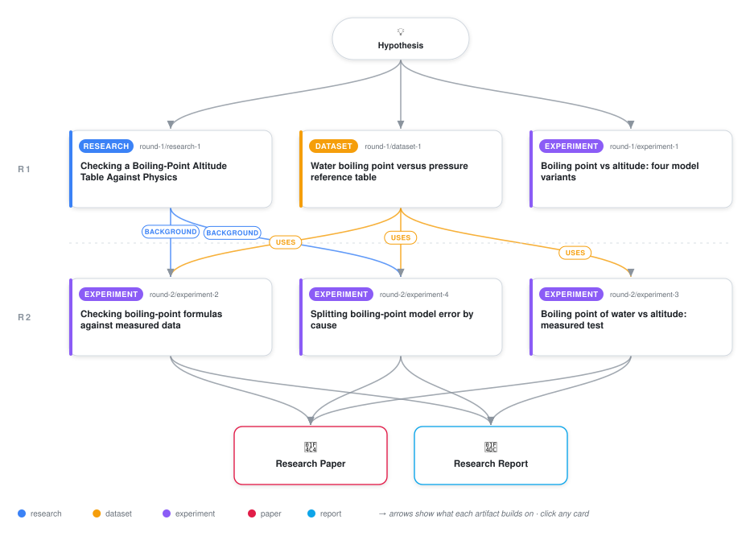

# Isothermal Barometric Boiling Points Match a Computed Table to 0.6 K

<div align="center">

<a href="https://cdn.jsdelivr.net/gh/ai-inventor-papers/ai-invention-fde7b3-simple-barometric-model-vs-boiling-point@main/workflow.svg">
<picture>
  <source media="(prefers-color-scheme: dark)" srcset="workflow-dark.svg">
  
</picture>
</a>

<sub>🖱️ <b><a href="https://cdn.jsdelivr.net/gh/ai-inventor-papers/ai-invention-fde7b3-simple-barometric-model-vs-boiling-point@main/workflow.svg">Open the interactive diagram</a></b> — every card links to its artifact folder.</sub>

</div>

> **TL;DR** — A simple barometric model with a constant enthalpy of vaporisation (isothermal atmosphere) gives a mean residual of +0.50 K against the Engineering ToolBox boiling-point table at 6 to 9 km, with a maximum absolute residual of 0.59 K over 119 altitudes from 0 to 9.0 km. This is a single exploratory estimate against a computed reference, not an accuracy result: no measured boiling-point and station-pressure pairs could be recovered, so the model was not tested against measurements. The choice of atmosphere model matters more than the enthalpy approximation: the ISA lapse-rate model with constant enthalpy reads about -2.1 K lower at 6 to 9 km.

<details>
<summary>Full hypothesis</summary>

The isothermal barometric formula with a constant-enthalpy Clausius-Clapeyron step predicts independently measured boiling temperatures of water across station pressures from sea level to above 8 km within 1 K. Its residual against measurements is expected to grow with altitude. The ISA lapse-rate version is expected to be more accurate below 3 km and less accurate above 5 km. The Engineering ToolBox table is most likely a computed standard-atmosphere calculation (within 0.31 K of IAPWS-at-ISA below 5 km), so it is a provenance-checked reference only and does not count as measured evidence. Measured sets to be used: Osborne, Stimson and Ginnings (1939), the CRC Handbook table, Keene (1995), and high-altitude station or summit records, each with its source recorded. Supported only if the measured residuals meet the bands above; disconfirmed if the lapse-rate version is more accurate than the isothermal one at all measured altitudes.

</details>

[](https://ai-inventor-papers.github.io/ai-invention-fde7b3-simple-barometric-model-vs-boiling-point/) [](https://ai-inventor-papers.github.io/ai-invention-fde7b3-simple-barometric-model-vs-boiling-point/interactive.html)

[](https://cdn.jsdelivr.net/gh/ai-inventor-papers/ai-invention-fde7b3-simple-barometric-model-vs-boiling-point@main/paper.pdf) [](https://cdn.jsdelivr.net/gh/ai-inventor-papers/ai-invention-fde7b3-simple-barometric-model-vs-boiling-point@main/report.pdf) [](https://cdn.jsdelivr.net/gh/ai-inventor-papers/ai-invention-fde7b3-simple-barometric-model-vs-boiling-point@main/exec_summary.pdf) [](https://cdn.jsdelivr.net/gh/ai-inventor-papers/ai-invention-fde7b3-simple-barometric-model-vs-boiling-point@main/round-2/report.pdf) [](https://github.com/ai-inventor-papers/ai-invention-fde7b3-simple-barometric-model-vs-boiling-point/tree/main/paper_latex)

**Round reports:** [Round 1](https://cdn.jsdelivr.net/gh/ai-inventor-papers/ai-invention-fde7b3-simple-barometric-model-vs-boiling-point@main/round-1/report.pdf) · [Round 2](https://cdn.jsdelivr.net/gh/ai-inventor-papers/ai-invention-fde7b3-simple-barometric-model-vs-boiling-point@main/round-2/report.pdf)

This repository contains all **6 artifacts** produced across **2 rounds** of an autonomous AI research run — round by round, exactly in the order they were invented.

## Round 1

| Artifact | Type | Demo | Source | Builds on |
|----------|------|------|--------|-----------|
| **[Checking a Boiling-Point Altitude Table Against Physics](https://github.com/ai-inventor-papers/ai-invention-fde7b3-simple-barometric-model-vs-boiling-point/tree/main/round-1/research-1)** | [](https://github.com/ai-inventor-papers/ai-invention-fde7b3-simple-barometric-model-vs-boiling-point/tree/main/round-1/research-1) | [](https://github.com/ai-inventor-papers/ai-invention-fde7b3-simple-barometric-model-vs-boiling-point/blob/main/round-1/research-1/demo/research_demo.md) | [](https://github.com/ai-inventor-papers/ai-invention-fde7b3-simple-barometric-model-vs-boiling-point/tree/main/round-1/research-1/src) | — |
| **[Water boiling point versus pressure reference table](https://github.com/ai-inventor-papers/ai-invention-fde7b3-simple-barometric-model-vs-boiling-point/tree/main/round-1/dataset-1)** | [](https://github.com/ai-inventor-papers/ai-invention-fde7b3-simple-barometric-model-vs-boiling-point/tree/main/round-1/dataset-1) | [](https://colab.research.google.com/github/ai-inventor-papers/ai-invention-fde7b3-simple-barometric-model-vs-boiling-point/blob/main/round-1/dataset-1/demo/data_code_demo.ipynb) | [](https://github.com/ai-inventor-papers/ai-invention-fde7b3-simple-barometric-model-vs-boiling-point/tree/main/round-1/dataset-1/src) | — |
| **[Boiling point vs altitude: four model variants](https://github.com/ai-inventor-papers/ai-invention-fde7b3-simple-barometric-model-vs-boiling-point/tree/main/round-1/experiment-1)** | [](https://github.com/ai-inventor-papers/ai-invention-fde7b3-simple-barometric-model-vs-boiling-point/tree/main/round-1/experiment-1) | [](https://colab.research.google.com/github/ai-inventor-papers/ai-invention-fde7b3-simple-barometric-model-vs-boiling-point/blob/main/round-1/experiment-1/demo/method_code_demo.ipynb) | [](https://github.com/ai-inventor-papers/ai-invention-fde7b3-simple-barometric-model-vs-boiling-point/tree/main/round-1/experiment-1/src) | — |

## Round 2

| Artifact | Type | Demo | Source | Builds on |
|----------|------|------|--------|-----------|
| **[Checking boiling-point formulas against measured data](https://github.com/ai-inventor-papers/ai-invention-fde7b3-simple-barometric-model-vs-boiling-point/tree/main/round-2/experiment-2)** | [](https://github.com/ai-inventor-papers/ai-invention-fde7b3-simple-barometric-model-vs-boiling-point/tree/main/round-2/experiment-2) | [](https://colab.research.google.com/github/ai-inventor-papers/ai-invention-fde7b3-simple-barometric-model-vs-boiling-point/blob/main/round-2/experiment-2/demo/method_code_demo.ipynb) | [](https://github.com/ai-inventor-papers/ai-invention-fde7b3-simple-barometric-model-vs-boiling-point/tree/main/round-2/experiment-2/src) | <sub><i>uses:</i><br/>[dataset‑1&nbsp;(R1)](https://github.com/ai-inventor-papers/ai-invention-fde7b3-simple-barometric-model-vs-boiling-point/tree/main/round-1/dataset-1)<br/><i>background:</i><br/>[research‑1&nbsp;(R1)](https://github.com/ai-inventor-papers/ai-invention-fde7b3-simple-barometric-model-vs-boiling-point/tree/main/round-1/research-1)</sub> |
| **[Boiling point of water vs altitude: measured test](https://github.com/ai-inventor-papers/ai-invention-fde7b3-simple-barometric-model-vs-boiling-point/tree/main/round-2/experiment-3)** | [](https://github.com/ai-inventor-papers/ai-invention-fde7b3-simple-barometric-model-vs-boiling-point/tree/main/round-2/experiment-3) | [](https://colab.research.google.com/github/ai-inventor-papers/ai-invention-fde7b3-simple-barometric-model-vs-boiling-point/blob/main/round-2/experiment-3/demo/method_code_demo.ipynb) | [](https://github.com/ai-inventor-papers/ai-invention-fde7b3-simple-barometric-model-vs-boiling-point/tree/main/round-2/experiment-3/src) | <sub><i>uses:</i><br/>[dataset‑1&nbsp;(R1)](https://github.com/ai-inventor-papers/ai-invention-fde7b3-simple-barometric-model-vs-boiling-point/tree/main/round-1/dataset-1)</sub> |
| **[Splitting boiling-point model error by cause](https://github.com/ai-inventor-papers/ai-invention-fde7b3-simple-barometric-model-vs-boiling-point/tree/main/round-2/experiment-4)** | [](https://github.com/ai-inventor-papers/ai-invention-fde7b3-simple-barometric-model-vs-boiling-point/tree/main/round-2/experiment-4) | [](https://colab.research.google.com/github/ai-inventor-papers/ai-invention-fde7b3-simple-barometric-model-vs-boiling-point/blob/main/round-2/experiment-4/demo/method_code_demo.ipynb) | [](https://github.com/ai-inventor-papers/ai-invention-fde7b3-simple-barometric-model-vs-boiling-point/tree/main/round-2/experiment-4/src) | <sub><i>uses:</i><br/>[dataset‑1&nbsp;(R1)](https://github.com/ai-inventor-papers/ai-invention-fde7b3-simple-barometric-model-vs-boiling-point/tree/main/round-1/dataset-1)<br/><i>background:</i><br/>[research‑1&nbsp;(R1)](https://github.com/ai-inventor-papers/ai-invention-fde7b3-simple-barometric-model-vs-boiling-point/tree/main/round-1/research-1)</sub> |

## Repository Structure

Artifacts are grouped by the round of invention that produced them. Each
artifact has its own folder with source code and a self-contained demo:

```
.
├── round-1/                         # One folder per round of invention
│   ├── experiment-1/
│   │   ├── README.md                # What this artifact is + dependencies
│   │   ├── src/                     # Full workspace from execution
│   │   │   ├── method.py            # Main implementation
│   │   │   ├── method_out.json      # Full output data
│   │   │   └── ...                  # All execution artifacts
│   │   └── demo/                    # Self-contained demo
│   │       └── method_code_demo.ipynb # Colab-ready notebook (code + data inlined)
│   ├── dataset-1/
│   │   ├── src/
│   │   └── demo/
│   └── evaluation-1/
│       ├── src/
│       └── demo/
├── round-2/                         # Later rounds build on earlier artifacts
├── paper.pdf                        # Research paper
├── paper_latex/                     # LaTeX source files
├── report.pdf                       # Full internal report — every experiment, table and dead end
├── report_latex/                    # LaTeX source of the report
├── exec_summary.pdf                 # Executive summary of the report, at most four pages
├── chat/                            # Every prompt, response and tool call, per module
├── workflow.svg                     # Artifact dependency diagram (this page's header)
└── README.md
```

## Running Notebooks

### Option 1: Google Colab (Recommended)

Click the "Open in Colab" badges above to run notebooks directly in your browser.
No installation required!

### Option 2: Local Jupyter

```bash
# Clone the repo
git clone https://github.com/ai-inventor-papers/ai-invention-fde7b3-simple-barometric-model-vs-boiling-point
cd ai-invention-fde7b3-simple-barometric-model-vs-boiling-point

# Install dependencies
pip install jupyter

# Run any artifact's demo notebook
jupyter notebook <artifact_folder>/demo/
```

## Source Code

The original source files are in each artifact's `src/` folder.
These files may have external dependencies - use the demo notebooks for a self-contained experience.

---
*Generated by AI Inventor Pipeline - Automated Research Generation*
